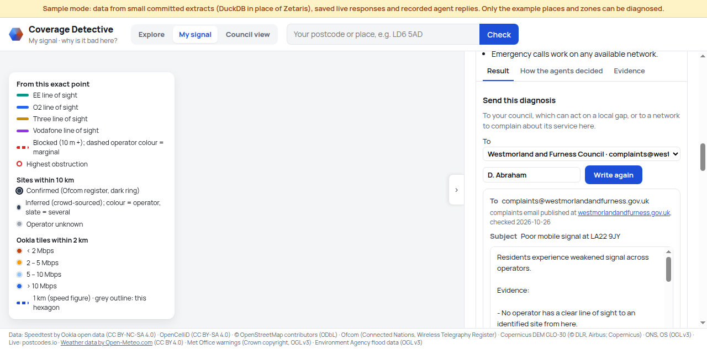
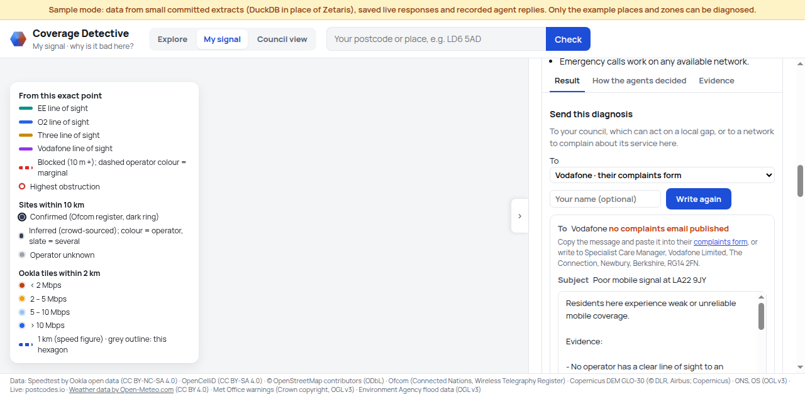

# Coverage Detective

**AI agents that explain why your mobile signal is bad, and show councils where to act, from real public data,
with every claim traced to its evidence and SQL.**

Open Agent Hackathon, **Track 2: The Agent That Can Explain Why**.


## Try it in 30 seconds

```bash
python3 -m venv .venv && .venv/bin/pip install -r requirements.txt
(cd meterless_service && npm install)     # Node 18+ (the agents' memory service)
.venv/bin/python run.py --sample          # then open http://localhost:8000/signal
```

No keys, no Docker, no network: sample mode replays recorded agent runs over small committed data extracts.
Then click:

1. **Great Langdale**: `/signal?lat=54.445&lon=-3.105` → **Diagnose with agents**. Hills block every network;
   open **Evidence** to see each item and the SQL behind it, then send the diagnosis to the council or to the network.
2. **Near Rhayader**: `/signal?lat=52.30&lon=-3.51` → Diagnose → **How the agents decided**: the critic
   challenges a belief, asks for a check, and a second round runs.
3. **Council view** → `/council?zone=Z00072` (**Ousby**) → Diagnose zone: the recommended new site, the
   people it would reach, and **Today / With candidate 1** on the map.

## The problem

Many people in the UK still have poor mobile signal where they live (our data finds 677 poorly served zones,
265,000 people), but nobody tells them **why**: is it the
hills, the distance to the mast, a single network, a busy cell, or today's storm? Operators' network data is
private, Ofcom's checker predicts coverage but does not explain it, and councils deciding where to push for
new masts have spreadsheets, not reasons.

- **Residents**: "why is my signal bad here, which network is likely best, what can I do?", plus a letter to
  send with the evidence attached.
- **Councils**: "which places are worst served, why, what fix would help most people, and where are the
  cheaper upgrade opportunities?"

## What it does

| My signal (`/signal`) | Council view (`/council`) | Explore (`/`) |
|---|---|---|
|  |  |  |
| One exact spot: likely causes ranked with confidence, what was ruled out, the likely best network, what to do, and an email to the council or to a network with the evidence attached. | **Gap zones** (poorly served people) and **improvement opportunities** (not poorly served, but a measurable weakness), ranked by a transparent score with adjustable weights; a fix view with candidate mast sites; agent diagnoses and a priority summary for any area. | The data itself, cell by cell: speeds, mast sites, operators, terrain and line of sight, Ofcom figures. |

| How the agents decided | The fix view | Every claim has its evidence |
|---|---|---|
|  |  |  |

## Sending the diagnosis

A finished diagnosis becomes an email to the resident's council, found from the point's local authority, or to
one of the four networks. **Write the email** asks the letter writer for a draft to that recipient by name, the
guard checks it, and code adds the address, the subject, a signature with the postcode, coordinates and the
diagnosis reference, and the `mailto` link. **Open in email app** hands the message to the resident's own mail
client, and the app never sends anything itself. **Copy message** and **Download .md** cover the rest.

The addresses come from `data/reference/council_contacts.csv` (21 councils) and `operator_contacts.csv`. Each row
records the page that published the address and the date someone checked it, and
`scripts/check_outreach.py` re-checks the rows. EE and O2 publish complaints email addresses; Three and Vodafone
publish a complaints form and a postal address only, so those get the form, the address and Copy, and the panel
says there is no email rather than inventing one. A council missing from the table gets gov.uk's council finder,
never a guessed address.




## How it works

```
 public data ──► Zetaris ──► evidence API ──► agents ◄──► Meterless ──► pages
 (Ookla, masts,   (one        (findings with   (investigate,   (shared case     (My signal,
  Ofcom, DEM,      source per   strength, data   diagnose,       file + World     Council view,
  live APIs)       dataset)     period and SQL)  critique, act)  Model)           Explore)
                                      ▲                │
                                      └── code guard ──┘   checks every agent's output
```

**The agent loop** (`coverage_detective/agents/coordinator.py`), up to 3 rounds:

```
investigate ─► diagnose ─► critique ─► the critic asked for checks and round < 3? ─ yes ─► investigate again
                                            │ no
                                            ▼
                     act: advisor (a place)  /  fix planner ⇄ critic review (a zone)
```

- **Investigator** picks tools (speeds, trend, sites, line of sight per operator, terrain, Ofcom area, live
  conditions, earlier diagnoses); each writes evidence items with stable ids, a strength and their SQL.
- **Diagnostician** ranks causes from a fixed set (distance to mast, terrain, single operator, capacity strain,
  weather, active incident, insufficient data) with confidence, citing evidence ids.
- **Critic** approves, asks for specific checks (another round), downgrades or rejects, with reasons: are the
  citations real, is the evidence strong enough, was an alternative left unchecked, does the cause fit the
  time pattern (a storm cannot explain a year of slow speeds).
- **Advisor** writes the answer for a resident, council officer or operator; for zones the **fix planner**
  proposes a fix from the candidate sites and the critic reviews it.
- Agents never message each other: each reads and writes the run's case file in Meterless.

**The code guard** runs after every agent and records every intervention: citations to evidence that does not
exist are removed (a belief left with none is dropped); a belief resting only on weak evidence (under 30 tests,
crowd-sourced sites, unknown operators, a region-wide warning) is capped at 0.5; every number must match the
cited evidence (one rewrite, then the sentence is removed); earlier diagnoses are context, never support; a
confidence change needs a reason; opportunities are never called gaps. An agent failing twice gives a partial
result built from the evidence.

**"Insufficient data" is a valid answer.** Where nothing is measured and no site is known, the answer says so
(`remote_powys`: "Not enough data to say why ...") instead of guessing, and "no site in our data" is never
presented as "no coverage".

## Sponsor tech

**Zetaris: the evidence layer.** Every dataset is its own Zetaris Lightning source (15 Parquet sources such as
`CD_CELLS`, `CD_OOKLA_MOBILE`, `CD_MASTS_SITES`, `CD_OFCOM_AREA`, `CD_LOS`, `CD_GAP_ZONES`, plus the live REST
source `CD_LIVE_EA_FLOODS`), and the agents' tools query them with federated SQL: one query per place joins
cells, Ookla speeds and history, masts, Ofcom, terrain and line of sight. Every query is logged with the
evidence it produced, so each claim on screen opens to its SQL. Row counts, freshness and query times
(70-520 ms): [docs/data_report.md](docs/data_report.md).

**Meterless: the shared case file.** We integrate the open-source Meterless **H-MEM** and **World Model**
reference engines (Apache 2.0, vendored unchanged in `vendor/meterless/`, served by our `meterless_service/`).
Our agents write evidence, beliefs, critiques and notes to H-MEM; every belief revision is a trust-ledger
update (who, old → new confidence, why), and that ledger *is* the "How the agents decided" trace. The World
Model holds each place or zone, its sites per operator with the line-of-sight result, warnings, candidate
sites and events; earlier diagnoses nearby are recalled as context for new runs.

**NVIDIA Nemotron: the model layer** (OpenAI-compatible API). **Nemotron 3.5 Super** runs the investigator
(tool calling, median 1 s a call), diagnostician (strict JSON schema, median 2 s), advisor (6 s), letter writer
and fix planner (1 s): fast and reliable with constrained output. **Nemotron 3 Ultra** with thinking runs the
critic (median 39 s), where careful reasoning matters most. Bursts of server errors are retried (2 s, 6 s),
then the other model answers; both are shown in the trace. A whole run takes 49-180 s live; replay takes 2 s.

**Cursor:** _[how we used Cursor: to be filled in]_

## Example runs

| Example | What it shows | Agents' headline | Rounds | Live run |
|---|---|---|---:|---:|
| [`great_langdale`](examples/great_langdale/) | hills block every operator (terrain 0.70); evidence letters to the operator, council and MP | Hills between you and the nearest masts are the likely cause. | 1 | 81 s |
| [`near_rhayader`](examples/near_rhayader/) | **the critic loop**: it asks for a check, a second round runs, a weak belief is downgraded | Terrain blocking EE and Three signals is the likely cause. | 2 | 180 s |
| [`central_london`](examples/central_london/) | fast measured service: "no strong cause" (good data, nothing above 0.3) | No strong cause was found; the service measures well here. | 1 | 49 s |
| [`sutton_st_edmund`](examples/sutton_st_edmund/) | flat Fens: distance, not terrain | Distance to the nearest mast is the likely cause. | 1 | 72 s |
| [`remote_powys`](examples/remote_powys/) | **insufficient data**: no tests and no site within 10 km | Not enough data to say why: there are no measured speeds at this point or within 1 km and no mast sites in our data within 10 km, so operators could not be identified. | 1 | 54 s |
| [`zone_ousby`](examples/zone_ousby/) | gap zone with no measurements: candidate sites, fix plan reviewed by the critic | No strong cause was found because there are no recent measurements. | 1 | 96 s |
| [`opportunity_windermere`](examples/opportunity_windermere/) | improvement opportunity: capacity upgrade, opportunity wording checked | Busy-network capacity strain is the likely cause. | 1 | 92 s |
| [`summary_uk`](examples/summary_uk/) | priority summary of the sample area (gap and opportunity sections) |  |  |  |
| [`summary_westmorland`](examples/summary_westmorland/) | priority summary for one council |  |  |  |

Each folder has the result, the Meterless trace, the evidence with SQL, the World Model and the recorded
replies. They were recorded live on sample data, so `run.py --sample` replays them exactly.

## Running it with the full data

Prerequisites: Python 3.12, Node 18+, Docker with the **Zetaris** platform bundle (sponsor-provided, default
`~/zetaris-platform`), an **NVIDIA API key**, and (only to rebuild the data from scratch) an OpenCelliD token.

```bash
cp .env.example .env     # set ZETARIS_URL / USER / PASSWORD, LLM_API_KEY, LLM_MODEL, LLM_MODEL_REASONING
scripts/zetaris/compose.sh up -d          # Zetaris with our read-only data mount
.venv/bin/python run.py                   # http://localhost:8000 (starts Meterless too)
```

The data itself (about 5 GB of downloads, a few hours to build) and registering it in Zetaris are described in
[docs/technical.md](docs/technical.md).

## Repository layout

| Folder | What it holds |
|---|---|
| `coverage_detective/` | the Python package: evidence API, agents (prompts, guard, loop), Zetaris and sample-mode clients, planning (zones, scores, siting), FastAPI app |
| `web/` | the three pages (plain HTML/JS, MapLibre + deck.gl) |
| `meterless_service/` | our small Node HTTP service over the Meterless engines (the agents' memory) |
| `vendor/meterless/` | the Meterless H-MEM and World Model reference engines, vendored unchanged (Apache 2.0) |
| `scripts/` | data downloads and builds, Zetaris registration, the data report, sample extracts, recording examples, screenshots |
| `examples/` | the 7 recorded runs and 2 summaries replayed by sample mode |
| `sample_data/` | small committed extracts of every Zetaris source, DEM crops and saved live responses |
| `data/` | the data manifest, reference tables and data notes (built data, runs and memory stores are gitignored) |
| `docs/` | technical reference, data report, screenshots |
| `tests/` | offline tests (no Zetaris, network or key) |
| `zetaris/` | the Docker Compose overlay that mounts our data into Zetaris |

## Data sources and licences

Ookla open data (CC BY-NC-SA 4.0), OpenCelliD (CC BY-SA 4.0), OpenStreetMap (ODbL), Ofcom Wireless Telegraphy
Register and Connected Nations, ONS boundaries (OGL), WorldPop (CC BY 4.0), Copernicus DEM GLO-30, and live
postcodes.io, Open-Meteo, Met Office warnings and Environment Agency floods. Because Ookla's licence is
non-commercial, the data and everything derived from it are **for non-commercial use**; the attribution footer
on every page must be kept. Details: [THIRD_PARTY.md](THIRD_PARTY.md). Our code: [MIT](LICENSE).

## Limitations and honesty

- **Causes are inferred, not confirmed.** Operators' network data is not public.
- **No building-level data.** Everything is at an exact point or a ~5 km² hexagon; indoor signal, walls and
  local clutter are not modelled.
- **Ookla has no time-of-day data**: quarterly aggregates only, so congestion can only be inferred ("capacity
  strain"), and many places have few or no tests.
- **Crowd-sourced mast sites are incomplete and approximate**, so "no site found" is weak evidence; operators
  are often inferred, not confirmed.
- **Ofcom figures are area-level** (constituency / council) predictions, not coverage at your address; use
  Ofcom's own [checker](https://www.ofcom.org.uk/mobile-coverage-checker) for that.
- **Line of sight is an estimate**: a surface model (trees and buildings partly included), antenna heights
  mostly assumed (25 m), no radio propagation model. "Blocked" means weaker, not none.
- **A contact address can go stale.** The table records where each address came from and when it was checked;
  run `scripts/check_outreach.py --to all` before a release. A long letter does not fit in a `mailto` link, so a
  cut message keeps the letter's start and the sign-off and leaves the full text to Copy.
- **Sample mode is a slice**: rankings are within the sample only (e.g. "#4 of 4"), only the example places and
  zones can be diagnosed, and Explore shows cell details but not the UK-wide map layers (15 MB, built from the
  full data).
- Mobile networks only; home broadband is out of scope.

**What we would do next:** deprivation and rural-urban "need" in the council score; power cuts as an
incident cause; flood warnings for Scotland, Wales and Northern Ireland; operator-confirmed site data or Ofcom's
postcode API if access is granted; a radio propagation model for candidate sites; validation against
measured drive tests.

## Validation: comparison with the Ofcom checker

_[To be filled in.]_

## Development

```bash
.venv/bin/python -m pytest -q                       # 123 offline tests, including sample mode end to end
.venv/bin/python scripts/record_examples.py         # re-record the examples (live model, needs LLM_API_KEY)
.venv/bin/python scripts/build_samples.py           # rebuild the sample extracts from the full data
.venv/bin/python scripts/check_data.py              # the data report through Zetaris
```

**The prompts are frozen.** `examples/index.json` stores a hash of `coverage_detective/agents/prompts/`, and a
test fails if a prompt changes after the examples were recorded. Recorded replies are keyed by example + agent
+ round + call; a missing one fails clearly and never falls back to a live call.
More: [docs/technical.md](docs/technical.md), project notes in `CLAUDE.md`.
